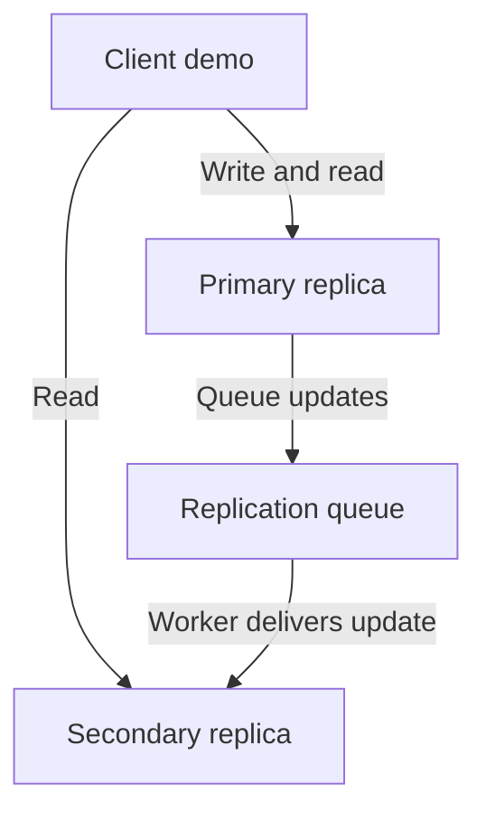

# Module 8: Replication & Consistency

This lab simulates an inventory system with one Primary replica, one Secondary replica, and a client that can read either replica. Writes update the Primary immediately and enter a queue for asynchronous replication to the Secondary.

## Run the program

Requirements: Python 3.8 or newer. The program uses only the Python standard library.

From this repository's directory, run:

```bash
python3 inventory.py
```

To save your terminal output as evidence:

```bash
python3 inventory.py | tee evidence/output.txt
```

The program runs all three scenarios automatically and exits. A successful run ends with `ALL CHECKS PASSED` while an unexpected inventory value raises an error. All state is in memory so every run starts fresh.

## Architecture



Both replicas are separate objects with independent stock values inside one Python process. `main()` acts as the client and selects which replica to read. An `asyncio` background task delivers updates in queue order with a simulated 0.5-second network delay. The Primary write returns before Secondary delivery completes.

Pausing replication blocks delivery while the replicas continue accepting reads and the Primary continues accepting writes. Resuming replication releases the queued update. Recovery here means catching up after a replication pause. The simulation does not implement process crashes, durable storage, or failover.

## Scenarios and results

| Scenario | Action | Primary read | Secondary read | Result |
| --- | --- | --- | --- | --- |
| Normal replication, before delivery | Write stock=10 to Primary, both started at 0 | 10 | 0 | Primary receives the update first |
| Normal replication, after delivery | Wait for the queued update to finish | 10 | 10 | Successful replication |
| Stale read | Pause replication, write 10 -> 9, wait 0.75 seconds | 9 | 10 | Secondary returns an older value |
| Recovery and convergence | Resume replication, wait for delivery | 9 | 9 | Replicas agree again |

The stale-read observation occurs after a wait longer than the normal delivery delay, showing that the replication pause keeps the Secondary behind. The update remains queued for delivery. The program waits for the queue's work to finish before checking convergence, with a five-second timeout if delivery does not complete.

## Terminal evidence

The following output was captured from a successful run.

```text
1. Successful replication: initialize stock to 10
Both replicas initially contain stock=0
WRITE Primary: stock=10; update queued for Secondary
READ Primary: stock=10
READ Secondary: stock=0
PASS: Primary accepts the write before replication
REPLICATED Primary -> Secondary: stock=10
READ Primary: stock=10
READ Secondary: stock=10
PASS: Both replicas return 10 after replication

2. Stale read: pause replication and change 10 -> 9
REPLICATION PAUSED: reads and Primary writes remain available
WRITE Primary: stock=9; update queued for Secondary
READ Primary: stock=9
READ Secondary: stock=10
PASS: Secondary returns stale stock=10 while Primary returns 9

3. Recovery: resume replication
REPLICATION RESUMED
REPLICATED Primary -> Secondary: stock=9
READ Primary: stock=9
READ Secondary: stock=9
PASS: Replicas converge to stock=9

ALL CHECKS PASSED
```

## Reflection

Reading directly from a Secondary replica can be faster because the client does not have to wait for replication to finish. However, the Secondary may temporarily return an old value if it has not received the latest update from the Primary. To guarantee that the client sees the latest value, it may need to read from the Primary or wait until replication is complete, which can make the read slower. In this lab, the Secondary remains readable while replication is paused, but it returns 10 until the queued update brings it to 9. Overall, a quick read may return a stale value while a consistent read could lead to higher latency.
